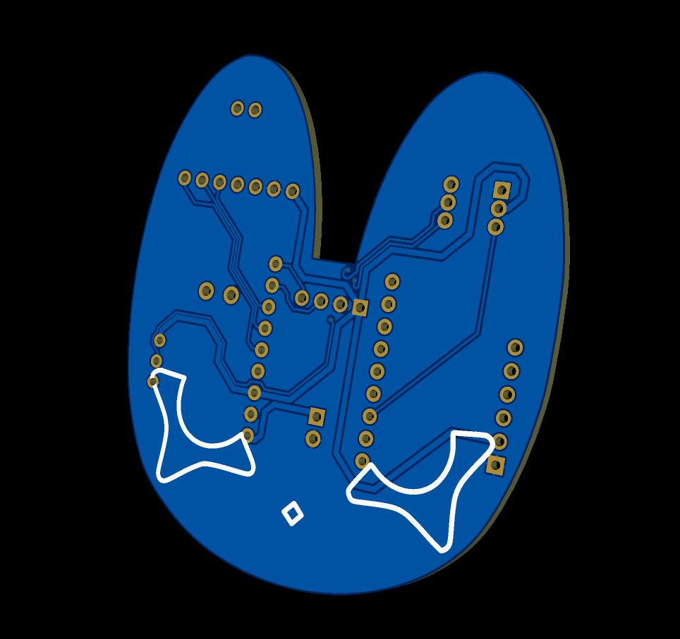
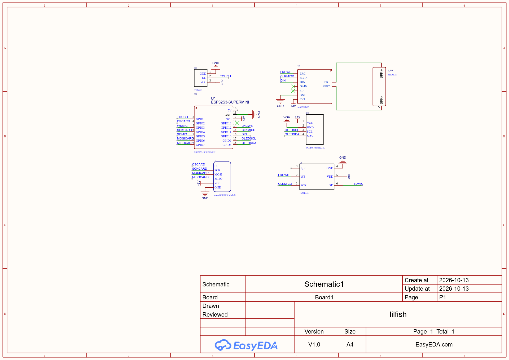
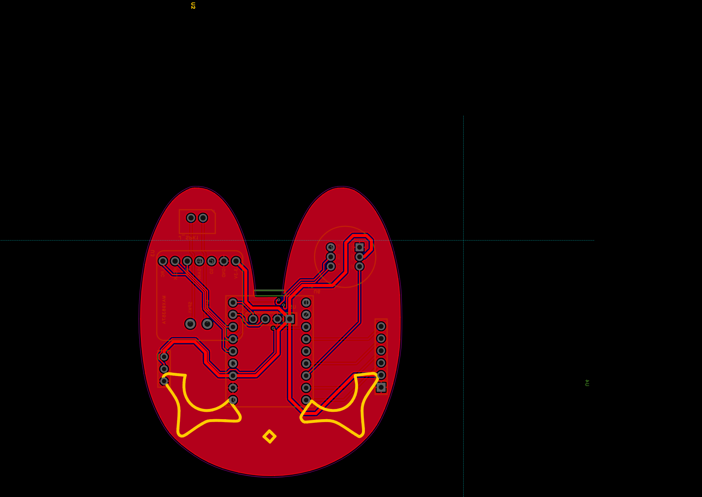

# WHOSHHH

i actually have no idea why i give the 'WHOSH' name, i just out of creativity now, in the next update i will update the name to something like xxx.v2!

ever wonder what if you use something that really you? i do! i always thingking about a hairpin that has an emotion, a face and can talk back to you, such a little adventure companion! but here is thing, what if it is too big or too impossible to be real?

not again!

meet whosh! your only hairpinpanion! (hairpin+companion) :D

you must be wonder what it does!

## feature

do'nt underestimate this little hairpinpanion! my products will never disappoint you! not once! trust me :P
apart from its cuteness cyber wearables fashion thingie here is few things you NEED TO KNOW

1.it plays MUSIC! who don't love music dude?
2.it has AI, yes as companion, you should never do fraud with this little kind creature
3.it has face! yes EMOTION! you'll get few task and you MUST complete it, bonding relationship++
4.your AI actually TALKS BACK! you could talk and get response as long as you have interneet connection! (don't worry i provide little talk when you are in jungle and unable to get internet)
5.you could PAT it and it will be soooooo HAPPY! yes yes there will be so fun!
6.use it! what else do you expect huh?

## how it works why should i have it

don't ask me now, this thing is unborn yet (uh what did i say) jk

whatever, maybe i should sorry for make this a bit too unformal, no why it must be formal? i will try to be formal next time but not now

as you could see, how simple this little hardware, everything is really tidy and breakout board on pcb, yes because it is v1 doofus don't expect something more than working prototype (god i hope it works)

for the main controller it is not limited to what kind of controller, i mean you could use 2 option, since the pinout is the same CMIIW, i mean (again) you could use either esp32c3 and esp32s3 as long as it is espressif and super mini version, the different thing is the battery, if you want to use esp32c3 then you shoul connect the battery to 5v pin and tp4056 to make it chargeable since they don't support builtin battery management.

what makes it hear you? as you could see, i use INMP441 so it has ears! to hear you ofcourse, and i use amplifier max98357a so it could talks back to you! just don't make it has a bad personal and whispering fraud, i will not let it happen!

so basically it works as a companion and i know how lonely you are, trust me you are so lonely that is why you need to get one! apart from being lonely, you might feel so bored all the time, and this thingie will never let you bored and maybe it could give you friend? because in future i will make an app! and you'll find another WHOSH user! and maybe you'll become less lonely!!

## bill of material

|no   |component                                  |qty|price|total    |total all+shipping (Rp.60.000)|total in USD|purchase link                                                                                                                                          |
|-----|-------------------------------------------|---|-----|---------|------------------------------|------------|-------------------------------------------------------------------------------------------------------------------------------------------------------|
|1    |ESP32-C3 SuperMini ESP32 Development Board |1  |42000|42000    |53101.0                       |$2.62       |https://shopee.co.id/ESP32-C3-SuperMini-ESP32-Development-Board-Wifi-Bluetooth-for-Arduino-MCU-IoT-i.199826381.51563151787                             |
|2    |INMP441 Microphone Sensor                  |1  |35000|35000    |44251.0                       |$2.19       |https://shopee.co.id/INMP441-Microphone-Sensor-Compatible-INMP441-MEMS-I2S-24-Bit-Digital-Audio-VCC-1.8–3.3V-i.888000018.57454327728                   |
|3    |Modul MAX98357A Amplop I2S                 |1  |50000|50000    |63216.0                       |$3.12       |https://shopee.co.id/Modul-MAX98357A-Amplop-I2S-dengan-Chip-AKK-BBH-PCB-Warna-Ungu-i.136926151.56567609449                                             |
|4    |Mini Micro SD Card Reader Module TF Card   |1  |11000|11000    |13907.0                       |$0.69       |https://shopee.co.id/Mini-Micro-SD-Card-Reader-Module-Mini-MicroSD-Module-TF-Card-Mini-i.86759930.27407252499                                          |
|5    |Set Konektor JST XH 2.54mm (2pin-6pin)     |2  |3000 |6000     |7586.0                        |$0.38       |https://shopee.co.id/Set-Konektor-JST-XH-2.54mm-2pin-3pin-4pin-5pin-6pin-(Male-PCB-Header-Female-Housing-Kabel)-i.28462644.55166812890                 |
|6    |Layar OLED 0.96 Inch I2C                   |1  |30000|30000    |37930.0                       |$1.88       |https://shopee.co.id/Layar-OLED-0.96-Inch-I2C-Kuning-Biru-Putih-Tampilan-Jernih-Konsumsi-Daya-Rendah-Kompatibel-dengan-Arduino-i.1555409167.49905302568|
|7    |TTP223 Touch Sensor Capacitive Module      |1  |1000 |1000     |1264.0                        |$0.06       |https://shopee.co.id/TTP223-Touch-Sensor-Capacitive-Module-Sensor-Sentuh-TTP-223-Touch-Key-Switch-i.3764991.49665158268                                |
|8    |Battery Baterai Lipo 1S 3.7V 1200mAh 103040|1  |40000|40000    |50573.0                       |$2.5        |https://shopee.co.id/Battery-Baterai-Lipo-1S-3.7v-3.7Volt-1200mAh-103040-printer-speaker-i.7849796.18590600205                                         |
|9    |Jepit Aligator Slim 5cm-6cm isi 12pc       |1  |12000|12000    |15172.0                       |$0.75       |https://shopee.co.id/Jepit-Aligator-Slim-5cm-6cm-isi-12-pc-Jepit-Buaya-Jepit-Rambut-i.17057716.29993157283                                             |
|total|                                           |   |     |Rp.227000|Rp.287000                     |$15         |                                                                                                                                                       |
